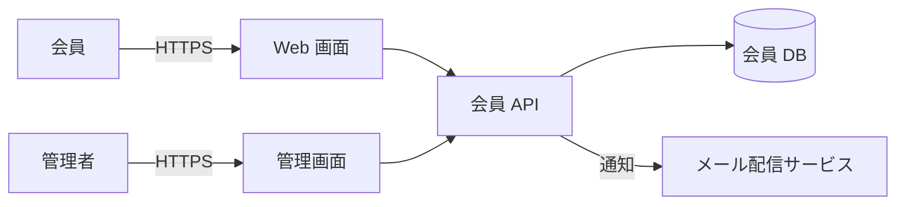
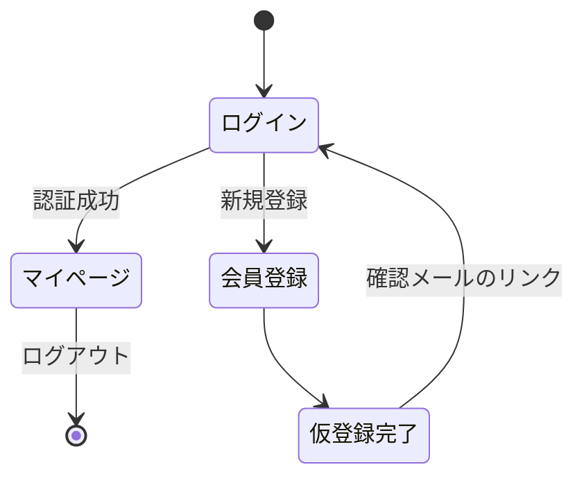
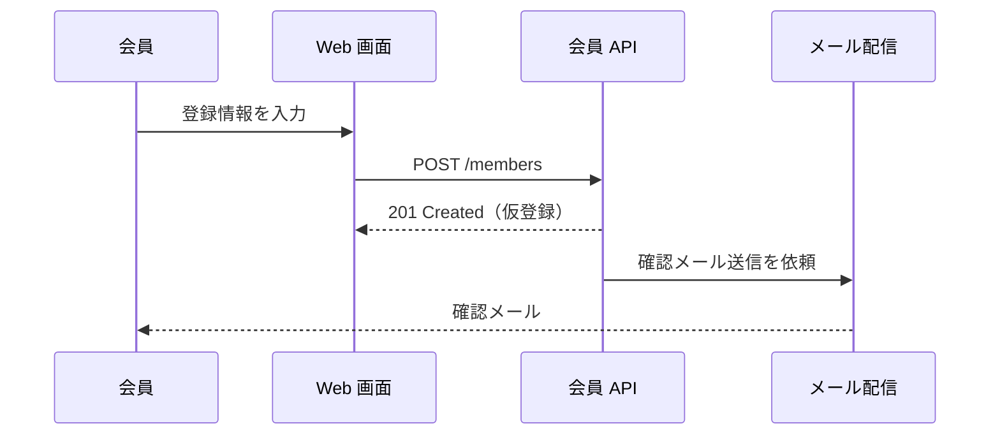

## 1. 文書概要

本書は、会員管理システムの外部仕様（画面・機能・外部インターフェース）を定義する。md2html の表示確認用サンプルであり、記載内容は架空のものである。

> [!NOTE]
> 内部処理の詳細（クラス設計・テーブル定義の物理設計）は内部設計書で扱う。

> [!IMPORTANT]
> 本書の変更は変更管理表に記録し、レビュー承認後に反映すること。

### 1.1 改訂履歴

| 版 | 日付 | 内容 |
|---|---|---|
| 1.0 | 2026-10-01 | 初版 |
| 1.1 | 2026-10-16 | 会員登録 API のエラー仕様を追記 |

## 2. システム構成



## 3. 画面一覧

| 画面 ID | 画面名 | 利用者 | 概要 |
|---|---|---|---|
| SCR-001 | ログイン | 会員 / 管理者 | ID とパスワードで認証する |
| SCR-002 | 会員登録 | 会員 | 必要事項を入力して仮登録する |
| SCR-003 | マイページ | 会員 | 登録情報の参照・変更 |
| SCR-101 | 会員検索 | 管理者 | 条件を指定して会員を検索する |

### 3.1 画面遷移



## 4. 機能仕様

### 4.1 会員登録

1. 会員が SCR-002 で必要事項を入力する
2. システムは入力値を検証し、仮登録状態で会員を作成する
3. 確認メールを送信する
   - 有効期限は 24 時間
   - 期限切れの場合は再送できる



#### 入力項目

| 項目 | 必須 | 形式 | 備考 |
|---|---|---|---|
| メールアドレス | ○ | RFC 5322 準拠 | 登録済みの場合はエラー |
| 氏名 | ○ | 全角 50 文字以内 | |
| パスワード | ○ | 12 文字以上、英数記号を含む | |

> [!WARNING]
> パスワードは画面・ログ・メールのいずれにも平文で出力しないこと。

## 5. 外部インターフェース

### 5.1 会員登録 API

`POST /api/v1/members`

```json
{
  "email": "taro@example.com",
  "name": "山田 太郎",
  "password": "********"
}
```

| ステータス | 意味 |
|---|---|
| 201 | 仮登録成功 |
| 400 | 入力値エラー |
| 409 | メールアドレス重複 |

## 6. 未決事項

- [x] パスワードポリシーの確定
- [ ] 退会時のデータ保持期間
  - [ ] 法務部門への確認
- [ ] 管理画面のアクセス元制限

用語
: 仮登録 — 確認メールのリンクが押されるまでの、ログインできない状態[^1]

[^1]: 本サンプルでの定義。
